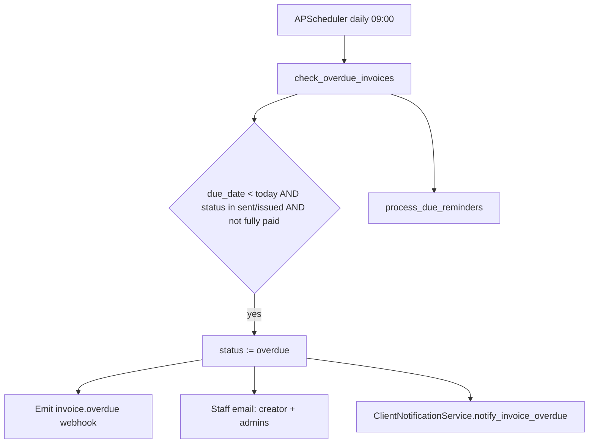
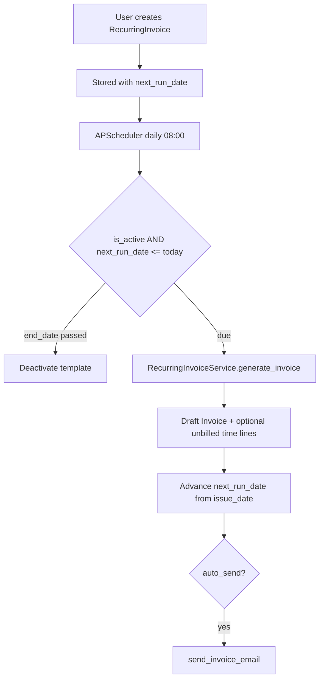

# Past-due invoice reminders and recurring invoices

How TimeTracker handles overdue invoice notifications, multi-step dunning, and automated recurring billing. Requires `SCHEDULER_ENABLED` (default on) so APScheduler can run the daily jobs.

## Past-due status + staff/client notify

**Daily job:** `check_overdue_invoices` at **09:00** (app timezone).

### Flow

1. Selects unpaid invoices with `due_date < today` and status `sent` or `issued`.
2. Sets status to `overdue` and emits the `invoice.overdue` webhook.
3. Notifies staff (creator + admins) and optionally the client via the portal notification channel.
4. Then runs **multi-level reminder policies** (see below) via `process_due_reminders`.



### Key pieces

| Piece | Location |
|-------|----------|
| Job | `check_overdue_invoices()` in [`app/utils/scheduled_tasks.py`](../../app/utils/scheduled_tasks.py); cron `hour=9, minute=0` |
| Staff email | `send_overdue_invoice_notification` → [`app/templates/email/overdue_invoice.html`](../../app/templates/email/overdue_invoice.html) |
| Staff prefs | `email_notifications` + `notification_overdue_invoices` (Settings → Notifications) |
| Client notify | [`ClientNotificationService.notify_invoice_overdue`](../../app/services/client_notification_service.py) |
| Webhook | `invoice.overdue` via `emit_invoice_event` |

**Status gate:** once an invoice is `overdue`, the overdue-status query no longer rematches it for the status flip. Repeat client outreach uses **reminder policies**, not the one-shot overdue notify.

### Manual trigger

There is no admin HTTP route for the overdue job. In an app context:

```python
from app.utils.scheduled_tasks import check_overdue_invoices
check_overdue_invoices()
```

---

## Reminder policies and late fees (dunning)

Configurable multi-step dunning is **shipped**. Policies define ordered levels with day offsets relative to the invoice due date; optional late fees accrue on the invoice.

### How it works

1. Resolve policy for each unpaid invoice: **invoice override → client policy → system default**.
2. For each policy level where `(today - due_date).days >= days_offset` and no matching `InvoiceReminderSchedule` row has been sent yet:
   - Email the client ([`invoice_reminder.html`](../../app/templates/email/invoice_reminder.html))
   - Record `InvoiceReminderSchedule` (`last_sent_at`)
   - Optionally apply a late fee (`fixed` amount or `percent_annual` interest, capped)
3. Runs inside the same daily overdue job after status updates.

### Admin UI

- **Admin → Reminder policies** — create/edit/delete policies and levels (`app/templates/reminder_policies/`).
- **Client edit** — optional `reminder_policy_id` override.
- Invoice model fields: `reminder_policy_id`, `late_fee_amount` (included in outstanding balance).

### Key pieces

| Piece | Location |
|-------|----------|
| Models | [`ReminderPolicy`](../../app/models/reminder_policy.py), [`ReminderPolicyLevel`](../../app/models/reminder_policy.py), [`InvoiceReminderSchedule`](../../app/models/payments.py) |
| Service | [`process_due_reminders`](../../app/services/invoice_reminder_service.py) |
| Migration | `211_invoice_reminder_policies.py` |

---

## Recurring invoices

**What exists today:** `RecurringInvoice` templates that periodically create normal `Invoice` rows. Module id: `recurring_invoices` (depends on `invoices`).

### Flow

1. User creates a recurring template with frequency, interval, and `next_run_date`.
2. Daily at **08:00**, `generate_recurring_invoices` runs.
3. For each active template with `next_run_date <= today`, it generates a draft invoice (optional time lines), advances `next_run_date`, and optionally emails the client.



### Key pieces

| Piece | Location |
|-------|----------|
| Model | [`RecurringInvoice`](../../app/models/recurring_invoice.py) — `frequency` (`daily` / `weekly` / `monthly` / `yearly`), `interval`, `next_run_date`, optional `end_date`, client/project/tax/currency, `auto_send`, `auto_include_time_entries` |
| Generation | [`RecurringInvoiceService.generate_invoice`](../../app/services/recurring_invoice_service.py) → draft `Invoice` with `recurring_invoice_id` |
| Line items | Unbilled billable time on the project when `auto_include_time_entries` is on — **no fixed subscription line items** on the template |
| Job | `generate_recurring_invoices()` in [`app/utils/scheduled_tasks.py`](../../app/utils/scheduled_tasks.py) at **08:00** |
| Web UI | Finance sidebar → Recurring Invoices; templates under [`app/templates/recurring_invoices/`](../../app/templates/recurring_invoices/) |
| API | `/api/v1/recurring-invoices` (CRUD + `POST .../<id>/generate`) |

### Manual generate

- **Web “Generate Now”:** forces the template due today, creates the invoice, redirects to edit. Does **not** auto-send email.
- **API `POST /api/v1/recurring-invoices/<id>/generate`:** generates when the template is due (no force-today hack). Auto-send still applies only via the scheduled job path.

### Cadence notes

- At most **one invoice per template per scheduler run**.
- After generation, `next_run_date` is computed from the generation `issue_date` (not from the previous `next_run_date`), so late runs re-anchor the cadence.
- Empty drafts can still be created and the schedule advanced (no unbilled time, or auto-include off).
- `template_id` exists on the model/API but is not exposed in the web create/edit forms.

---

## Side-by-side

| Concern | Past-due + dunning | Recurring invoices |
|---------|-------------------|--------------------|
| Scheduler | Daily **09:00** | Daily **08:00** |
| Core unit | Existing `Invoice` → `overdue` + reminder levels | `RecurringInvoice` → new `Invoice` |
| Client email | Overdue portal notify + policy reminder emails | Full invoice email if `auto_send` |
| Repeat outreach | Yes (policy levels / offsets) | Yes (every period while active) |
| Still missing | Fixed subscription line items on recurring templates | Same |

## Related docs

- [Invoice feature README](../INVOICE_FEATURE_README.md)
- [Payment tracking](../PAYMENT_TRACKING.md) (payments vs overdue alerts)
- [Webhooks](webhooks.md) (`invoice.overdue`, payment/credit-note events)
- [Timezone convention](../dev/TIMEZONE_CONVENTION.md) (calendar “today” for these jobs)
- [Email configuration](../admin/configuration/EMAIL_CONFIGURATION.md)
- [Smart notifications](SMART_NOTIFICATIONS.md) (unrelated time-tracking reminders)
