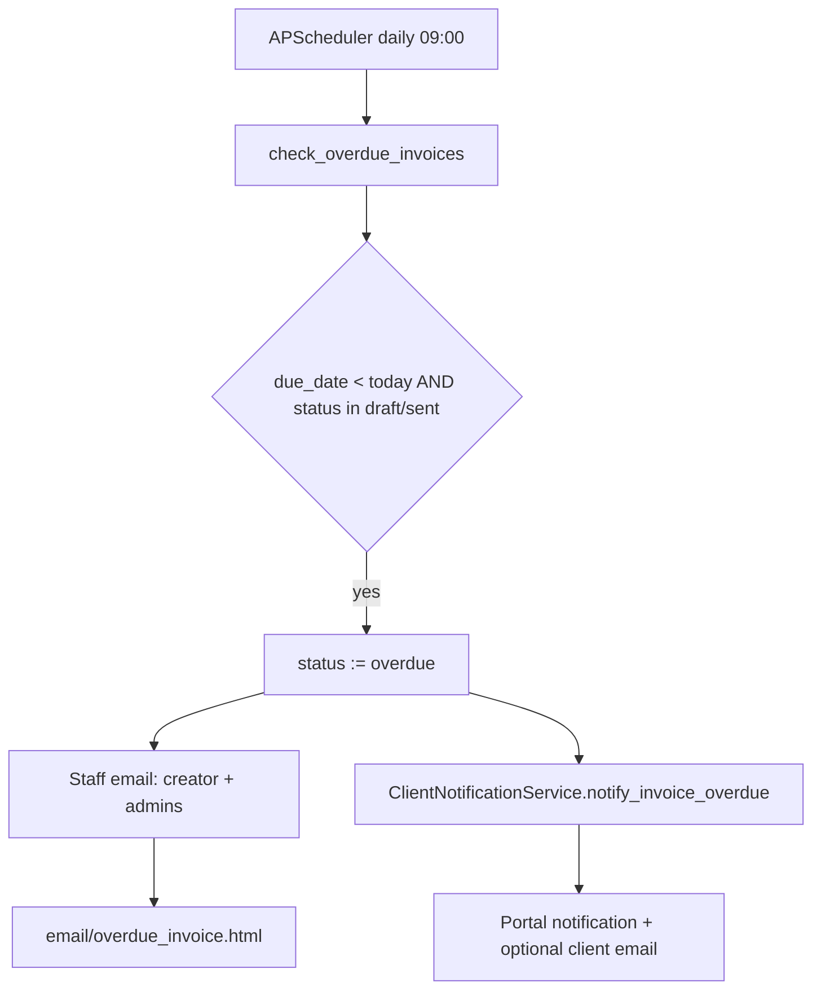
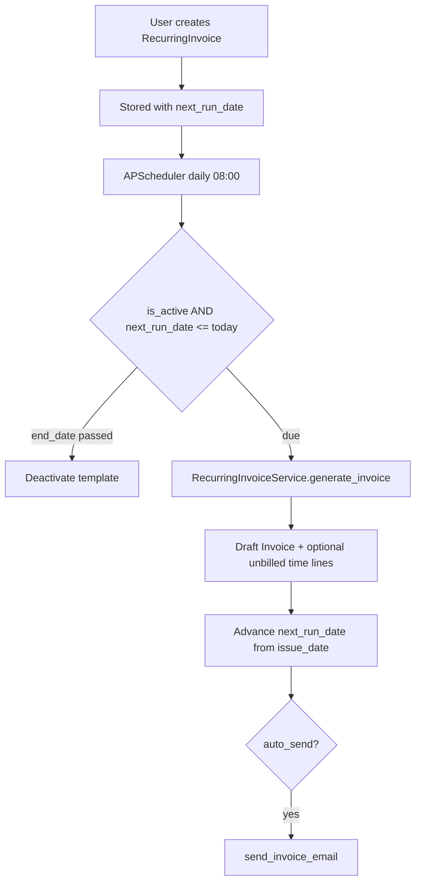

# Past-due invoice reminders and recurring invoices

How TimeTracker handles overdue invoice notifications and automated recurring billing. Requires `SCHEDULER_ENABLED` (default on) so APScheduler can run the daily jobs.

## Past-due invoice reminders

**What exists today:** a single daily APScheduler job — not a configurable multi-step dunning ladder.

### Flow

1. Daily at **09:00** (app timezone), `check_overdue_invoices` runs.
2. It selects invoices with `due_date < today` and status `draft` or `sent`.
3. Sets status to `overdue`.
4. Notifies staff and (optionally) the client.



### Key pieces

| Piece | Location |
|-------|----------|
| Job | `check_overdue_invoices()` in [`app/utils/scheduled_tasks.py`](../../app/utils/scheduled_tasks.py); cron `hour=9, minute=0` (hard-coded) |
| Staff email | `send_overdue_invoice_notification` → [`app/templates/email/overdue_invoice.html`](../../app/templates/email/overdue_invoice.html) |
| Staff prefs | `email_notifications` + `notification_overdue_invoices` (Settings → Notifications) |
| Client notify | [`ClientNotificationService.notify_invoice_overdue`](../../app/services/client_notification_service.py) → portal + generic [`client_notification.html`](../../app/templates/email/client_notification.html) |
| Client prefs | `email_invoice_overdue` on client notification preferences |

**One-shot behavior:** after status becomes `overdue`, the job query no longer matches that invoice, so there are **no repeat “past due” reminder emails** on later days.

### Manual trigger

There is no admin HTTP route. In an app context:

```python
from app.utils.scheduled_tasks import check_overdue_invoices
check_overdue_invoices()
```

### Not wired (schema / docs only)

- [`InvoiceReminderSchedule`](../../app/models/payments.py) (`days_offset`, `template_name`, `last_sent_at`) exists in the DB/model only — no job, routes, or UI consume it.
- No pre-due nudges and no +7/+14 day ladder.
- An `invoice.overdue` webhook is mentioned in docs in places, but the overdue job does not emit it.

---

## Recurring invoices

**What exists today:** `RecurringInvoice` templates that periodically create normal `Invoice` rows. Module id: `recurring_invoices` (depends on `invoices`).

### Flow

1. User creates a recurring template with frequency, interval, and `next_run_date`.
2. Daily at **08:00**, `generate_recurring_invoices` runs.
3. For each active template with `next_run_date <= today`, it generates a draft invoice (optional time lines), advances `next_run_date`, and optionally emails the client.



### Key pieces

| Piece | Location |
|-------|----------|
| Model | [`RecurringInvoice`](../../app/models/recurring_invoice.py) — `frequency` (`daily` / `weekly` / `monthly` / `yearly`), `interval`, `next_run_date`, optional `end_date`, client/project/tax/currency, `auto_send`, `auto_include_time_entries` |
| Generation | [`RecurringInvoiceService.generate_invoice`](../../app/services/recurring_invoice_service.py) → draft `Invoice` with `recurring_invoice_id` |
| Line items | Unbilled billable time on the project when `auto_include_time_entries` is on — **no fixed subscription line items** on the template |
| Job | `generate_recurring_invoices()` in [`app/utils/scheduled_tasks.py`](../../app/utils/scheduled_tasks.py) at **08:00** |
| Web UI | Finance sidebar → Recurring Invoices; templates under [`app/templates/recurring_invoices/`](../../app/templates/recurring_invoices/) |
| API | `/api/v1/recurring-invoices` (CRUD + `POST .../<id>/generate`) |

### Manual generate

- **Web “Generate Now”:** forces the template due today, creates the invoice, redirects to edit. Does **not** auto-send email.
- **API `POST /api/v1/recurring-invoices/<id>/generate`:** generates when the template is due (no force-today hack). Auto-send still applies only via the scheduled job path.

### Cadence notes

- At most **one invoice per template per scheduler run**.
- After generation, `next_run_date` is computed from the generation `issue_date` (not from the previous `next_run_date`), so late runs re-anchor the cadence.
- Empty drafts can still be created and the schedule advanced (no unbilled time, or auto-include off).
- `template_id` exists on the model/API but is not exposed in the web create/edit forms.

---

## Side-by-side

| Concern | Past-due reminders | Recurring invoices |
|---------|-------------------|--------------------|
| Scheduler | Daily **09:00** | Daily **08:00** |
| Core unit | Existing `Invoice` → `overdue` | `RecurringInvoice` → new `Invoice` |
| Client email | Generic portal notification email | Full invoice email if `auto_send` |
| Repeat outreach | No (status gate) | Yes (every period while active) |
| Richer schema unused | `InvoiceReminderSchedule` | Fixed line-item templates (none) |

## Related docs

- [Invoice feature README](../INVOICE_FEATURE_README.md)
- [Payment tracking](../PAYMENT_TRACKING.md) (payments vs overdue alerts)
- [Timezone convention](../dev/TIMEZONE_CONVENTION.md) (calendar “today” for these jobs)
- [Email configuration](../admin/configuration/EMAIL_CONFIGURATION.md)
- [Smart notifications](SMART_NOTIFICATIONS.md) (unrelated time-tracking reminders)
